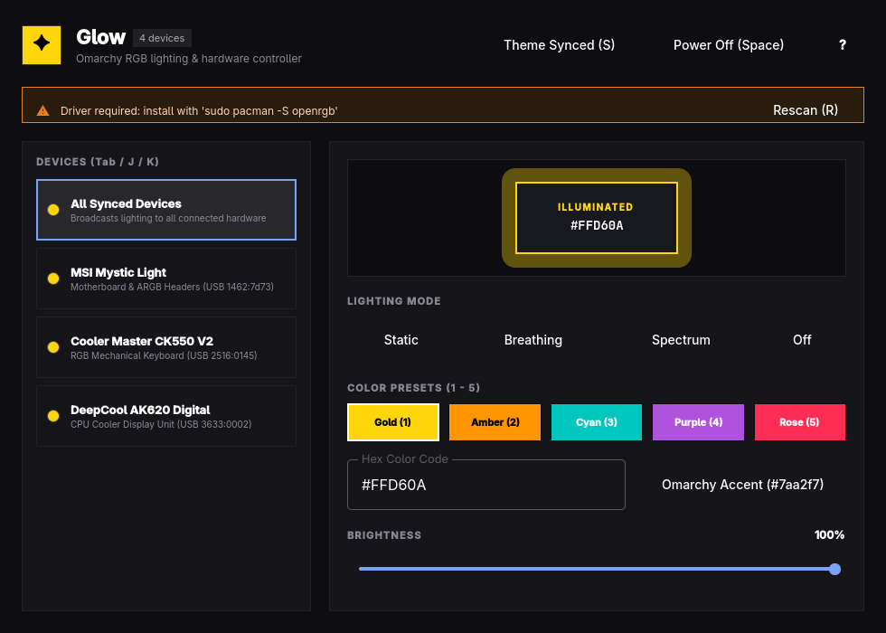

# Glow



A fast, keyboard-driven RGB lighting and hardware controller for the Omarchy desktop.

Glow controls your PC's RGB lighting (motherboards, keyboards, coolers, and strips), monitors Thermaltake fan temperatures and curves live, and syncs your lighting to your active Omarchy desktop theme accent or system thermals.

## Features

- **Thermaltake Fans & Thermals**: Live temperature monitoring from hardware sensors (CPU, RAM, NVMe), animated fan speed indicators, curve estimators, and fan profile presets (Silent, Standard, Performance, Full Speed).
- **Thermal Reactive Lighting (`T`)**: Dynamically shifts case RGB lighting based on fan and CPU temperatures (Cool Cyan → Healthy Green → Warm Amber → Alert Crimson).
- **Omarchy Theme Sync (`S`)**: Matches your motherboard and keyboard RGB to your desktop accent color live.
- **Hardware Integration**: Supports Thermaltake fans (Riing, SWAFAN, TOUGHFAN), MSI Mystic Light, Cooler Master keyboards (e.g. CK550 V2), DeepCool devices, and any hardware supported by OpenRGB.
- **Lighting Modes**: Static color, Breathing pulse, Rainbow spectrum, Thermal Reactive, and complete blackout.
- **Keyboard-First**: Full keyboard navigation, thermal toggles, and color preset shortcuts.
- **Driver Diagnostics**: Automatically detects OpenRGB drivers, udev access, and connected hardware.

## Keyboard Shortcuts

| Key | Action |
| --- | --- |
| `Space` | Toggle lighting On / Off |
| `S` | Sync lighting with current Omarchy desktop accent |
| `T` | Toggle Thermal Reactive lighting mode (reacts to fan temperatures) |
| `1` – `5` | Switch to color preset (Gold, Amber, Cyan, Purple, Rose) |
| `Tab` / `J` | Focus next detected hardware device |
| `K` | Focus previous detected hardware device |
| `R` | Rescan hardware, thermal sensors, and drivers |
| `?` | Toggle shortcut cheat-sheet overlay |
| `Q` | Quit Glow |

## Requirements

Glow communicates directly with hardware via [OpenRGB](https://gitlab.com/CalcProgrammer1/OpenRGB) and the Linux `hwmon` subsystem:

```sh
sudo pacman -S openrgb
```

Installing OpenRGB sets up the appropriate `/usr/lib/udev/rules.d/60-openrgb.rules` permissions for non-root USB access.

## Building & Installing

Build the app:

```sh
./bin/build
```

Run test suite offscreen:

```sh
./bin/test
```

Install to app launcher:

```sh
./bin/install
```

## License

MIT © 2026 Arif Kamarudin (cyphr-dev). Portions © David Heinemeier Hansson (Omacut, Monologue).
